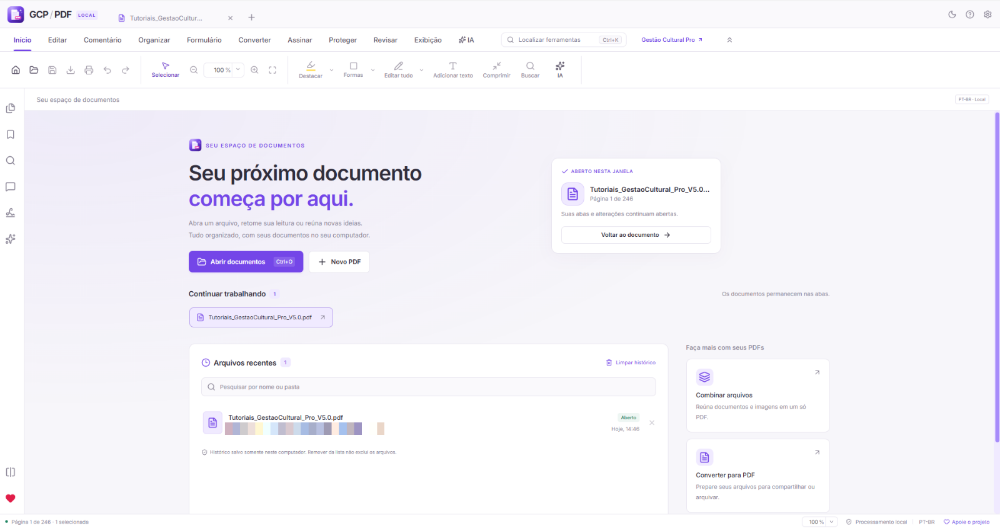
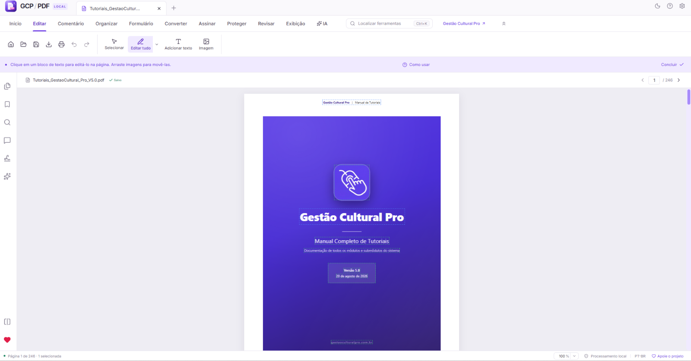
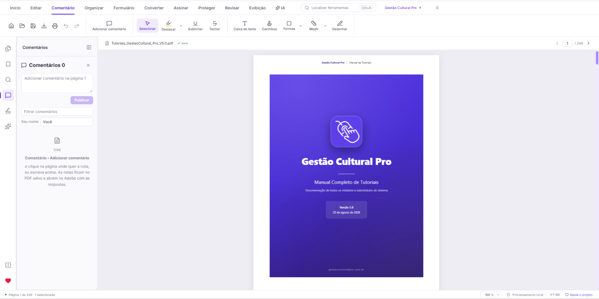
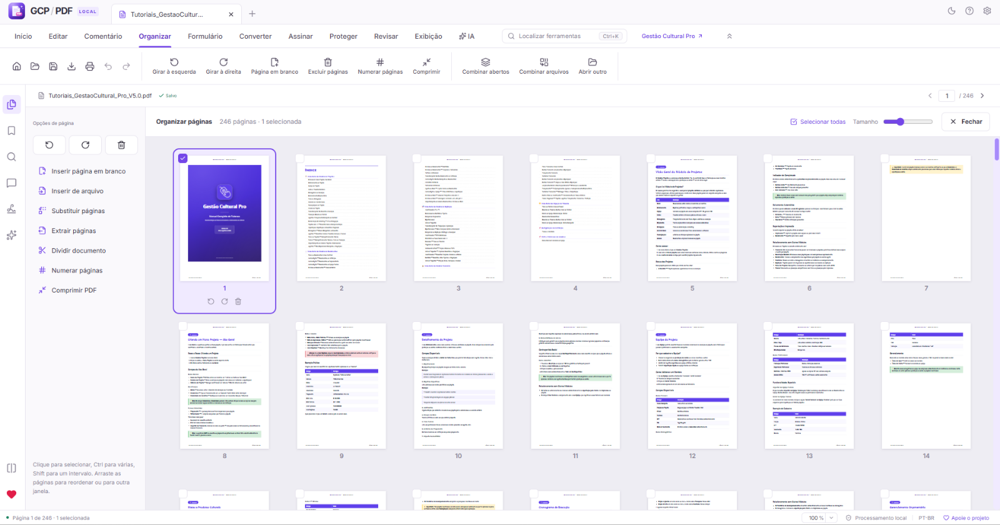
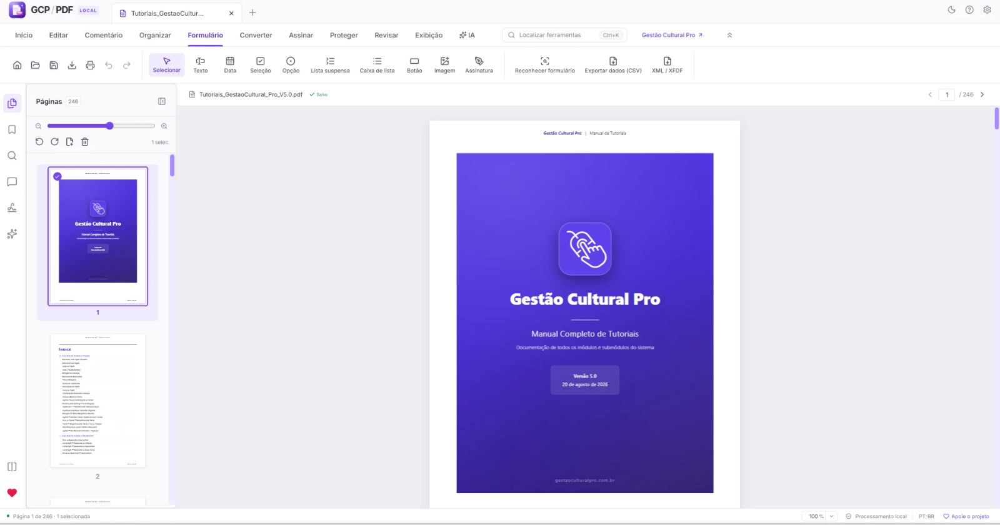
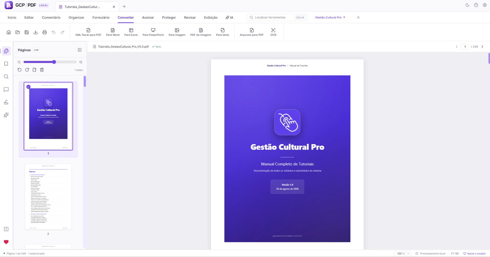
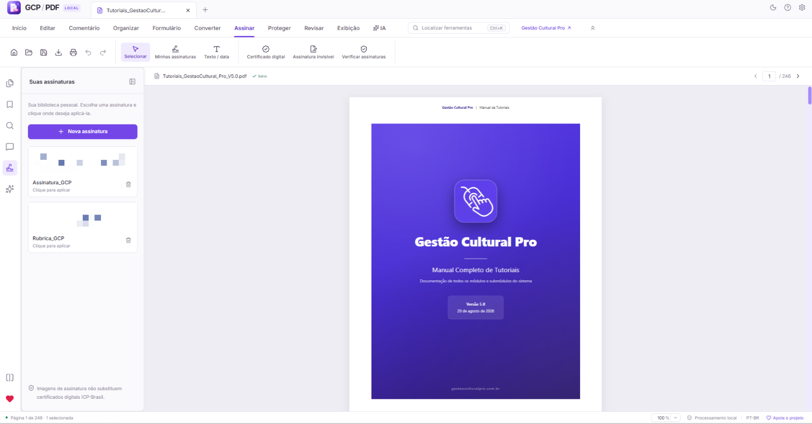

# GCP-PDF

**Leitor e editor de PDF completo, em português, que funciona no seu computador.**

O GCP-PDF reúne num só programa o que normalmente exige vários: ler, comentar, editar o texto e as imagens originais, organizar páginas, preencher e criar formulários, assinar com certificado digital ICP-Brasil, proteger e converter documentos. Tudo em português do Brasil, sem cadastro e com seus arquivos sempre no seu computador.

Desenvolvido por **Bruno Albertini | [Gestão Cultural Pro](https://gestaoculturalpro.com.br/)**.



## Telas

| | |
|---|---|
| <br>**Editar** — texto e imagens originais da página | <br>**Comentário** — notas, destaques, carimbos, formas e medidas |
| <br>**Organizar** — páginas em grade, girar, inserir, extrair e dividir | <br>**Formulário** — criação de campos, reconhecimento e exportação |
| <br>**Converter** — Word, Excel, PowerPoint, imagens e OCR | <br>**Assinar** — assinaturas, certificado digital ICP-Brasil e verificação |

## Baixar

Baixe a versão mais recente na página de [versões publicadas](https://github.com/cliqueprojeto/GCP-PDF/releases/latest):

- **GCP-PDF-Instalador-x.y.z-x64.exe** — instala no Windows 10 e 11 (64 bits), cria atalhos e adiciona as ações no menu do botão direito do Explorador de Arquivos.
- **GCP-PDF-Portatil-x.y.z-x64.exe** — roda sem instalar, por exemplo a partir de um pendrive.
- **GCP-PDF-x.y.z-linux-amd64.deb** — Ubuntu/Debian de 64 bits: instale pelo gerenciador de aplicativos ou com `sudo apt install ./GCP-PDF-x.y.z-linux-amd64.deb`.
- **GCP-PDF-x.y.z-linux-x86_64.rpm** — Fedora e distribuições compatíveis: `sudo dnf install ./GCP-PDF-x.y.z-linux-x86_64.rpm`.
- **GCP-PDF-x.y.z-linux-x86_64.AppImage** — versão portátil Linux: marque o arquivo como executável (`chmod +x arquivo.AppImage`) e abra. Requer FUSE 2; sem FUSE, extraia com `./arquivo.AppImage --appimage-extract` e execute `squashfs-root/AppRun`.
- **GCP-PDF-x.y.z-macOS-arm64.dmg** — Macs Apple Silicon (M1, M2 e posteriores).
- **GCP-PDF-x.y.z-macOS-x64.dmg** — Macs Intel. Abra o DMG e arraste o GCP-PDF para Aplicativos. Os arquivos `.zip` contêm o mesmo aplicativo.

**macOS:** os pacotes têm assinatura local (ad hoc), sem notarização Apple. Na primeira abertura, o sistema pode bloquear o aplicativo: tente abrir, vá a **Ajustes do Sistema › Privacidade e Segurança › Abrir Mesmo Assim** e confirme. Políticas de Macs gerenciados podem impedir essa autorização. Requisitos mínimos seguem os runtimes Electron e PdfCraft incluídos; os testes de distribuição são executados em macOS 15 para Intel e Apple Silicon e Ubuntu 22.04 x64.

Os hashes SHA-256 dos pacotes Linux/macOS ficam no arquivo `SHA256SUMS-linux-macOS.txt` da release. O motor PdfCraft 0.15.0 nativo está incluído em cada pacote.

Como o instalador ainda não tem assinatura digital de código, o Windows pode mostrar "O Windows protegeu o computador". Clique em **Mais informações** e depois em **Executar assim mesmo**.

O programa avisa quando houver uma versão nova, com a frequência que você escolher em **Configurações › Atualizações** (ou nunca). No Windows, o instalador é conferido pelo SHA-256 e executado automaticamente. No Linux e macOS, o aviso abre os downloads do GitHub para instalar o pacote correspondente.

**Certificado digital A1:** Windows, Linux e macOS permitem escolher o arquivo `.pfx`/`.p12` em **Assinar › Escolher arquivo A1**, informar a senha e assinar. A senha não fica salva. O aplicativo verifica a assinatura gerada antes de gravar o PDF. O Windows também lista certificados do sistema; o macOS lista identidades do Chaves. A confiança na cadeia depende das autoridades reconhecidas localmente: uma assinatura íntegra pode aparecer com cadeia não reconhecida. Confira certificados ICP-Brasil no validador do ITI. Tokens/cartões A3 fora do Windows não estão incluídos nesta compatibilidade.

**Atalhos e ações rápidas:** no Linux, o aplicativo aparece em **Escritório**. Após a primeira abertura, as ações **Combinar em um PDF** e **Converter para PDF** são configuradas por usuário: **Scripts › GCP-PDF** em Nautilus/GNOME e Caja, submenu **GCP-PDF** no Dolphin/KDE e ações com prefixo GCP-PDF no Nemo e Thunar. No macOS, arraste o aplicativo para **Aplicativos**; as ações do Finder são instaladas em `~/Library/Services` e aparecem em **Ações Rápidas** ou **Serviços**. Se necessário, habilite-as em **Ajustes do Sistema › Teclado › Atalhos de Teclado › Serviços**. Pode ser necessário reabrir o gerenciador de arquivos para atualizar o menu. Você pode desativar as ações em **Configurações › Ações rápidas nos arquivos**. As ações existentes são preservadas; backups de arquivos alterados ficam em `~/.local/share/gcp-pdf/integration-backups` (ou no diretório XDG de dados configurado).

Os demais formatos Office além de `.docx`, `.xlsx` e `.txt` podem exigir LibreOffice instalado separadamente.

## O que ele faz

### Ler
- Leitura contínua, em página única ou duas páginas lado a lado, com zoom, tela cheia e filtro noturno.
- Volta para a página e a posição onde você parou em cada arquivo.
- Página inicial com arquivos recentes, busca e documentos abertos em abas.
- Pesquisa no documento, marcadores (criados à mão ou a partir dos títulos) e miniaturas das páginas.

### Comentar e revisar
- Comentários em balões, destaque, sublinhado e tachado de texto.
- Caixas de texto, carimbos, formas, desenho à mão livre e medidas de distância, perímetro e área em centímetros.
- Comparação de dois PDFs, mostrando o que entrou, saiu ou mudou.

### Editar
- Edição do texto original da página, mantendo fonte, tamanho e cor.
- Imagens originais do PDF: mover, redimensionar, girar, espelhar, substituir, recortar, ajustar cores e salvar como arquivo.
- Inserção de texto, imagens e páginas em branco.

### Organizar
- Girar, excluir, extrair, copiar, colar e reordenar páginas arrastando as miniaturas.
- Combinar vários arquivos em um PDF e dividir um documento em partes.
- Numeração de páginas e numeração Bates.

### Formulários
- Preenchimento de formulários PDF, com máscaras automáticas para CPF, CNPJ, CEP, telefone, data e valores em reais.
- Criação de campos: texto, data, caixa de seleção, opções, lista suspensa, caixa de lista, imagem, assinatura e botões com ações (abrir link, ir para página, limpar e imprimir).
- Reconhecimento automático de formulários e exportação dos dados em CSV.

### Assinar e proteger
- Assinatura digital com certificado ICP-Brasil (A1 em arquivo ou A3 em token/cartão), com prévia da posição na página. Arquivos assinados no programa aparecem como válidos no [Validador do ITI](https://validar.iti.gov.br/).
- Verificação das assinaturas digitais de um documento, usando a cadeia de certificados confiáveis do Windows.
- Proteção com senha, remoção de dados ocultos e edição das propriedades do documento.
- Um PDF assinado nunca é sobrescrito por engano: alterações são salvas como cópia.

### Converter
- Exportar para Word, Excel, PowerPoint e PDF de imagens.
- Converter arquivos para PDF e criar um PDF novo em branco.
- Reconhecimento de texto (OCR) em português, feito no próprio computador.
- Compressão de PDF em vários níveis, com prévia do tamanho final.

## Privacidade

Os documentos são abertos, editados e salvos localmente. O GCP-PDF não exige conta e não envia seus arquivos para servidores. A conexão com a internet só é usada para verificar atualizações no GitHub, abrir links que você escolher e recursos opcionais que você mesmo configurar.

## Para desenvolvedores

O GCP-PDF é feito com Electron, React, TypeScript, PDF.js e pdf-lib. O motor de edição do conteúdo original das páginas é baseado no [PdfCraft](assets/pdfcraft/NOTICE).

Requisitos de desenvolvimento: Node.js da `.nvmrc` e npm indicado em `package.json`. Compile Linux no Linux e macOS no Mac da arquitetura correspondente.

```powershell
npm.cmd ci           # instala as dependências travadas
npm.cmd run dev      # abre o programa em modo de desenvolvimento
npm.cmd test         # roda os testes automatizados
npm.cmd run pack:win # gera o instalador e a versão portátil em release/
```

Em Linux/macOS, use `npm ci`, `npm run prepare:native`, `npm test` e `npm run pack:linux` ou `npm run pack:mac`. O download do motor oficial é fixado na versão 0.15.0 e conferido por SHA-256. O workflow **Instaladores Linux e macOS** compila em cada arquitetura, executa os testes, instala/extrai os pacotes e testa abertura, renderização, edição, OCR, assinatura A1 com certificado temporário e execução das ações rápidas no aplicativo empacotado. Esses testes não usam um certificado ICP-Brasil real nem token A3 e não cobrem visualmente todos os gerenciadores de arquivos. A publicação só começa quando os três jobs passam; a release indicada deve existir e ter a mesma versão do `package.json`. Assets já existentes não são sobrescritos. As evidências ficam nos artefatos do workflow. RPM é extraído e executado no Ubuntu; uma instalação em Fedora não está coberta por esse teste.

Como publicar uma versão nova está explicado em [docs/PUBLICAR.md](docs/PUBLICAR.md). O histórico de mudanças fica em [HISTORICO.md](HISTORICO.md).

Sugestões e problemas podem ser enviados na aba [Issues](https://github.com/cliqueprojeto/GCP-PDF/issues).

## Licença

Copyright © 2026 Bruno Albertini | Gestão Cultural Pro.

O GCP-PDF é software livre: você pode redistribuí-lo e modificá-lo sob os termos da **GNU General Public License, versão 3 ou posterior**, publicada pela Free Software Foundation. Ele é distribuído na esperança de ser útil, mas **sem nenhuma garantia**. Veja o arquivo [LICENSE](LICENSE).

Os componentes de terceiros (motor de edição, fontes, modelo de OCR e bibliotecas) mantêm suas próprias licenças, listadas em [THIRD_PARTY_NOTICES.md](THIRD_PARTY_NOTICES.md).
